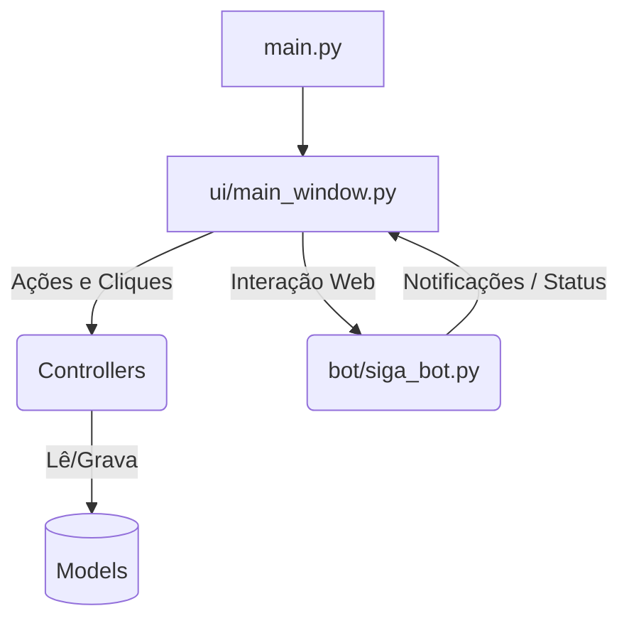

# Arquitetura do AutoSIGA

Bem-vindo ao guia arquitetural do **AutoSIGA**. Este documento foi desenhado para ajudar novos programadores a entender como o código-fonte está organizado após a grande refatoração de maio de 2026.

## 🏗️ Padrão Adotado: MVC (Model-View-Controller) Adaptado

O projeto originalmente era um arquivo monolítico de mais de 1.400 linhas. Agora, ele adota o padrão **MVC**, separando responsabilidades lógicas, de interface e de automação web.



### 1. Models (Acesso a Dados e Persistência)
Localizado na pasta `/models`, abriga classes que lidam exclusivamente com I/O (Input/Output). Nenhum Model sabe o que é uma janela ou um clique.
- **`config_manager.py`**: Acessa e edita o `config.json`. As chaves de energia (e-mail, localidades, UCs, faturas processadas) ficam no mixin `config_energia.py`; o catálogo de contas lido do SIGA (`catalogo_contas`), no mixin `config_catalogo.py`.
- **`faturas_pendentes.py`**: Guarda no `config.json` as faturas de energia cuja UC ainda não foi mapeada (e as descartadas pelo usuário), para que nenhuma se perca entre importações.
- **`ofx_reader.py`**: Traduz arquivos físicos `.ofx` para dicionários nativos do Python usando a biblioteca `ofxparse`.

### 2. Controllers (Lógica de Negócios)
Localizado em `/controllers`, contém a inteligência de processamento matemático e expurgo.
- **`conciliador.py`**: Pega a lista do banco (Model) e a lista do HTML (SigaBot) e compara uma com a outra com tolerância de até 1 centavo, identificando o que precisa ser lançado.
- **`catalogo_contas.py`**: Lê os rótulos das contas bancárias do SIGA (TES01701 e grade da CTB00301) em `ContaSiga`, comparando contas só pelos dígitos.
- **`sugestao_contas.py`**: Cruza o extrato com o catálogo (correspondência pela CC, pontuação por grupo, produto e localidade já usada) e sugere as contas; no empate, não escolhe.
- **`estado_card.py`**: Valida os códigos (grupo 101/103, existência e localidade no catálogo) e decide o selo do card e se ele libera a conciliação.
- **`exportador.py`**: Expurga palavras-chave (ex: "RESG.") e converte uma lista de transações em um arquivo `.txt` formatado em padrão ASP Brasileiro (separador por ponto e vírgula).

### 3. Bot (Automação / Headless)
Localizado em `/bot`. Devido à natureza robusta e assíncrona do Playwright, a automação ganhou um módulo exclusivo.
- **`siga_bot.py`**: Um esqueleto autônomo. Ele faz o bypass de campos complicados (Select2) e injeta dados. A classe `SigaBot` é composta por mixins: `siga_helpers.py` (Select2, loading, notificações, screenshot), `sessao.py` (Edge persistente e login), `extratos.py` (TES01701/01703/01704), `energia_auditoria.py` (TES01501), `energia.py` (TES01502), `ofertas.py` (TES05602) e `descoberta_contas.py` (catálogo de contas pela CTB00301 ou, sem acesso, pela TES01701 em cada localidade, restaurando o contexto no fim).
  > **🚨 IMPORTANTE**: O Bot roda numa *Thread Paralela*. Ele se comunica com a Interface Gráfica através de **Callbacks** para não congelar o sistema operacional do usuário.

### 4. View (Interface Gráfica)
Localizado em `/ui`.
- **`main_window.py`**: É o antigo arquivo gigante, agora purgado de regras de negócio. Usa o `CustomTkinter` para renderizar uma interface limpa. Mantém só janela e layout; o resto vem de mixins: `credenciais.py` (Keyring e `ModalCredenciais`), `lote_extratos.py` (arquivos e validação do lote), `acoes_siga.py` (thread do bot e callbacks via `self.after(0, ...)`), `dashboard.py` (autorização e produtividade), `catalogo_siga.py` (faixa "Buscar no SIGA" e "Confirmar sugestões"). O card de conta fica em `card_conta_extrato.py` e as cores, tiradas do tema do SIGA, em `tema.py`.
- **`panel_energia.py`** e **`modais_energia.py`**: Aba Energia (configuração do e-mail e lista de faturas pendentes) e seus modais (localidades, mapeamento de UCs e a pergunta de UC nova).
- **Thread-Safety**: Todo acesso à UI vindo do Bot passa pelo método `self.after(0, ...)`, garantindo que apenas a *Main Thread* pinte os pixels na tela.

## 🚀 Como Iniciar

O ponto de entrada absoluto do projeto é o `main.py` na raiz. 
Para rodar, basta ativar sua `venv` e executar:
```bash
python main.py
```

## 🛠️ Build do Executável

Sempre que criar uma versão nova para os usuários finais rodarem no Windows sem instalarem Python, utilize o PyInstaller apontando para o `main.py`:
```bash
pyinstaller --noconfirm AutoSIGA.spec
```
